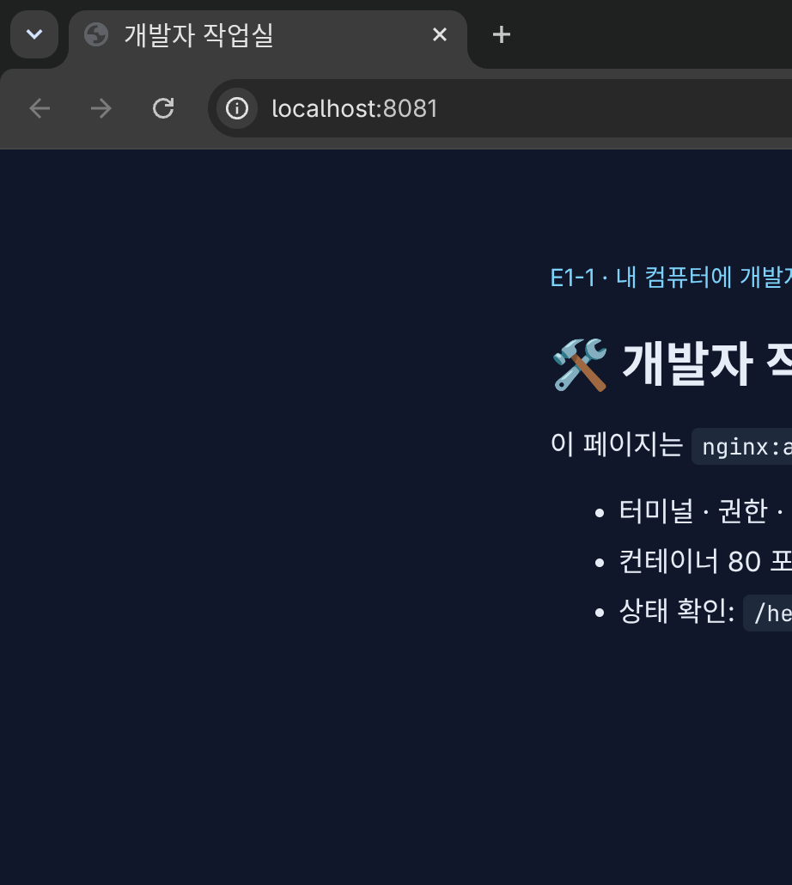
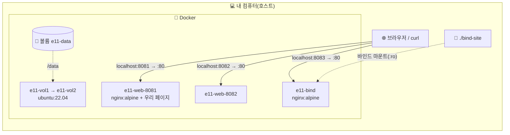
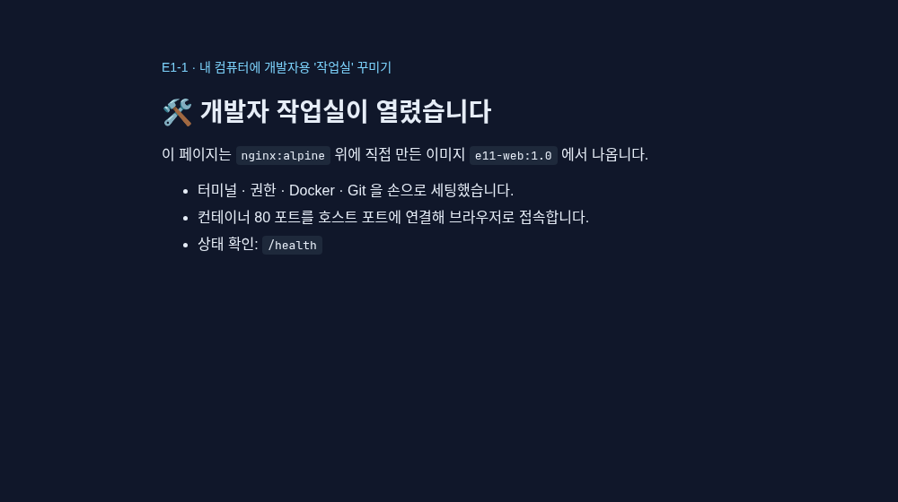
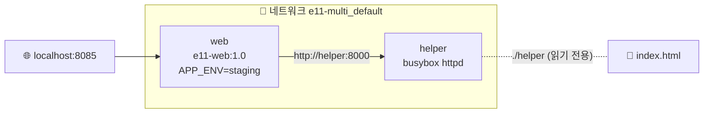

<div align="center">

# 🛠️ 개발자 작업실 꾸미기

### 터미널 · 권한 · Docker · Git 을 손으로 세팅하고 전부 기록했다


AI올인원 입학연수 · 개발 입문



<sub>직접 만든 이미지 <code>e11-web:1.0</code> 을 <code>-p 8081:80</code> 으로 띄워 브라우저로 접속한 화면</sub>

</div>

---

## 🧒 쉽게 말하면

> 새 집으로 이사 와서 **공부방(작업실)을 꾸미는 날**이라고 생각하면 된다.
> 책상 정리(폴더·파일 다루기), 서랍 자물쇠(권한), 어디서 열어도 똑같은 **도시락통**(Docker), 공부 일기장(Git)을 하나씩 갖춘다.

이 과제에서 쓰는 말 다섯 개만 그림으로 기억하면 된다.

| 말 | 비유 | 이 과제에서 |
|---|---|---|
| 🍱 **이미지** | 도시락 **만드는 법(레시피)** | `nginx:alpine`(웹 서버 레시피)에 우리 페이지를 얹어 `e11-web:1.0` 레시피를 새로 만들었다 |
| 📦 **컨테이너** | 레시피대로 실제로 싼 **도시락 한 통** | 같은 레시피로 도시락 두 통(`e11-web-8081`, `e11-web-8082`)을 쌌다 |
| 🚪 **포트** | 건물의 **현관 번호** | 내 컴퓨터 8081번 문으로 들어오면 도시락 안 80번 문으로 이어 준다(`-p 8081:80`) |
| 🪟 **바인드 마운트** | 도시락 뚜껑에 낸 **창문** | 내 컴퓨터 폴더를 고치면 도시락 안에서도 바로 바뀐다 |
| 💾 **볼륨** | 도시락 밖에 둔 **보관함** | 도시락(컨테이너)을 버려도 보관함 안 메모는 남는다 |

> [!TIP]
> **처음이면 [준비물](#-준비물) → [따라 하기](#-따라-하기) 두 절만 보면 된다.** 그 아래 1~11절은 과제 채점용 기록(이 컴퓨터에서 실제로 친 명령과 출력 원본)이다.

## 📚 목차
- 처음 하는 사람: [쉽게 말하면](#-쉽게-말하면) · [준비물](#-준비물) · [따라 하기](#-따라-하기) · [용어 사전](#-용어-사전)
- 과제 기록: [개요](#-프로젝트-개요) · [실행 환경](#-실행-환경) · [체크리스트](#-수행-체크리스트) · [1. 저장소](#-1-제출-저장소-및-기술-문서) · [2. 터미널](#️-2-터미널-조작-로그) · [3. 권한](#-3-권한-실습) · [4. Docker 점검](#-4-docker-설치-및-기본-점검) · [5. 운영 명령](#-5-docker-기본-운영-명령) · [6. 컨테이너](#-6-컨테이너-실행-실습)
- 과제 기록(계속): [7. 커스텀 이미지](#-7-기존-dockerfile-기반-커스텀-이미지) · [8. 포트](#-8-포트-매핑-및-접속-증거) · [9. 마운트·볼륨](#-9-바인드-마운트와-docker-볼륨) · [10. Git](#-10-git-설정-및-github-연동) · [11. 보안](#️-11-보안-및-개인정보-보호) · [트러블슈팅](#-트러블슈팅) · [보너스](#-보너스--docker-compose) · [정리](#-정리) · [설명](#-설명)

## 🧰 준비물
아무것도 몰라도 된다. 내 컴퓨터 종류에 맞는 줄만 보고 준비한다.

| 내 컴퓨터 | 터미널(글자로 명령을 치는 창) | Docker 설치 |
|---|---|---|
| 🪟 Windows | PowerShell 을 **관리자로** 열고 `wsl --install` → 재부팅 → 시작 메뉴의 **Ubuntu** 앱. 이 문서의 명령은 전부 **Ubuntu 창**에서 친다 | [Docker Desktop](https://www.docker.com/products/docker-desktop/) 설치 후 실행. 설정 → Resources → **WSL Integration** 에서 Ubuntu 를 켠다 |
| 🍎 macOS | `⌘ + Space` → `터미널` | [Docker Desktop](https://www.docker.com/products/docker-desktop/) 설치 후 실행(메뉴 막대에 고래 아이콘) |
| 🐧 Linux | `Ctrl + Alt + T` | 배포판 안내대로 Docker Engine 과 Compose 플러그인 설치([공식 문서](https://docs.docker.com/engine/install/)) |

설치가 됐는지 터미널에서 확인한다. 네 줄 모두 버전 숫자가 나오면 준비 끝이다.

```bash
# 설치 확인 — 버전이 한 줄씩 나오면 OK (숫자는 달라도 된다)
docker --version
docker compose version
git --version
curl --version | head -1
```

- 🌐 웹 브라우저(크롬·엣지·사파리 아무거나).
- 🚪 비어 있는 포트 8081~8085. 다른 프로그램이 쓰고 있으면 [트러블슈팅 2](#2-8080-포트--port-is-already-allocated)처럼 다른 번호를 쓰면 된다.
- 📂 이 저장소 파일. GitHub 저장소 페이지의 초록색 **[Code]** → **[Download ZIP]** 으로 받아 압축을 푼다(Git 을 알면 `git clone <저장소 주소>`).
  지금은 GitHub 에 올리기 전 초안이라, 올린 뒤 이 자리에 주소가 들어간다.
- 전제 지식: **없음.** 아래 명령을 위에서부터 그대로 복사해 붙여 넣으면 된다.

> [!NOTE]
> Linux 에서 `docker` 명령이 `permission denied` 를 내면 명령 앞에 `sudo ` 를 붙인다(예: `sudo docker ps`). 이 문서의 기록(1~11절)은 그래서 전부 `sudo docker` 로 되어 있다 — 이유는 [트러블슈팅 1](#1-docker-ps--permission-denied).
> Windows·macOS 의 Docker Desktop 은 `sudo` 가 필요 없다.

## 🚶 따라 하기
한 시간 안팎이면 끝난다. 각 단계마다 **칠 것 → 나와야 하는 화면 → 무슨 뜻인지** 순서로 적었다. 명령은 회색 상자를 통째로 복사해 터미널에 붙여 넣고 Enter.

1. **연습장 폴더를 만들고 들어간다.** (책상 서랍 하나를 비워 연습용으로 쓴다)
   ```bash
   # 홈 폴더로 가서 → 연습 폴더 만들고 → 그 안으로 들어가 → 지금 위치 확인
   cd ~
   mkdir -p workshop-practice
   cd workshop-practice
   pwd
   ```
   👀 `/home/내이름/workshop-practice`(macOS 는 `/Users/내이름/workshop-practice`)가 나오면 성공이다.

2. **파일과 폴더를 만들고, 복사하고, 이름을 바꾼다.**
   ```bash
   # 폴더 2개, 빈 파일 1개, 글이 든 파일 1개를 만들고 → 복사 → 이름 바꾸기 → 목록 보기
   mkdir notes docs
   touch README.md
   echo "작업실 첫 메모" > notes/todo.txt
   cat notes/todo.txt
   cp notes/todo.txt docs/
   mv docs/todo.txt docs/plan.txt
   ls -la . notes docs
   ```
   👀 `cat` 줄에서 `작업실 첫 메모` 가 나오고, 마지막 목록의 `docs:` 아래에 `plan.txt` 가 보이면 성공이다.

   | 명령 | 쉬운 뜻 |
   |---|---|
   | `pwd` | 나 지금 어디 있어? |
   | `mkdir 이름` | 폴더 만들어 |
   | `cd 이름` | 그 폴더로 들어가(`cd ..` = 한 칸 위로) |
   | `ls -la` | 여기 뭐 있어? 숨긴 것(`.` 으로 시작)까지 다 보여 줘 |
   | `touch 이름` | 빈 파일 만들어 |
   | `echo "글" > 파일` | 파일에 이 글을 써 |
   | `cat 파일` | 파일 내용 보여 줘 |
   | `cp 원본 어디로` / `mv 원본 새이름` | 복사해 / 옮겨(이름 바꾸기도 이걸로) |
   | `rm 파일` | 지워(휴지통 없이 바로 사라지니 조심) |

3. **서랍에 자물쇠를 건다 — 권한.**
   ```bash
   # 메모 파일을 나만 읽고 쓰게(600) 바꿨다가 → 원래대로(644) 되돌린다
   ls -l notes/todo.txt
   chmod 600 notes/todo.txt
   ls -l notes/todo.txt
   chmod 644 notes/todo.txt
   ```
   👀 맨 앞 글자가 `-rw-r--r--` → `-rw-------` 로 바뀌면 성공이다.
   💬 무슨 뜻? `r` 읽기 · `w` 쓰기 · `x` 실행. 세 칸씩 **나 / 우리 팀 / 남** 순서다. `-rw-------` 는 「나만 읽고 쓸 수 있고 다른 사람은 아무것도 못 한다」. 숫자로는 읽기 4 + 쓰기 2 + 실행 1 을 더해 `6`(나) `0`(팀) `0`(남) = `600`.

4. **Docker 가 깨어 있는지 인사해 본다.**
   ```bash
   # 버전 확인 → 연습용 「안녕」 컨테이너를 한 번 실행하고 바로 지운다(--rm)
   docker --version
   docker run --rm hello-world
   ```
   👀 아래 문장이 보이면 성공이다(처음엔 이미지를 내려받느라 몇 초 걸린다).
   ```text
   Hello from Docker!
   This message shows that your installation appears to be working correctly.
   ```
   🆘 `Cannot connect to the Docker daemon` 이 나오면 Docker 가 꺼져 있는 것이다 → Docker Desktop 앱을 켜고(Linux 는 `sudo systemctl start docker`) 다시 친다.

5. **리눅스 도시락 안에 들어가 본다.**
   ```bash
   # ubuntu 컨테이너를 만들어 그 안의 셸(bash)로 들어간다. 나오면(exit) 자동으로 지워진다(--rm)
   docker run -it --rm ubuntu:22.04 bash
   ```
   👀 줄 앞이 `root@3f2a…:/#` 처럼 바뀌면 **도시락 안**에 들어온 것이다. 안에서 이렇게 쳐 본다.
   ```bash
   # 컨테이너 안에서 — 어떤 리눅스인지 보고 나간다
   cat /etc/os-release | head -2
   exit
   ```
   👀 `PRETTY_NAME="Ubuntu 22.04.5 LTS"` 가 나오고, `exit` 뒤에는 원래 내 터미널로 돌아온다.
   💬 무슨 뜻? 내 컴퓨터가 Windows·macOS 여도 도시락 안은 Ubuntu 리눅스다. 이게 「어디서 열어도 똑같은 도시락」이다.

6. **우리만의 웹 서버 레시피(이미지)를 만든다.** 먼저 이 저장소 폴더로 옮겨 간다 — `cd ` 까지 치고(뒤에 빈칸 하나) 압축 푼 `E1-1` 폴더를 터미널 창으로 **끌어다 놓은** 뒤 Enter.
   ```bash
   # 지금 폴더의 Dockerfile(레시피)로 e11-web:1.0 이라는 이미지를 만든다 — 마지막 점(.)까지 꼭 친다
   docker build -t e11-web:1.0 .
   docker images e11-web
   ```
   👀 목록에 `e11-web:1.0` 한 줄이 보이면 성공이다.
   🆘 `failed to read dockerfile` 이 나오면 `E1-1` 폴더 밖에 있는 것이다 → `ls` 로 `Dockerfile` 이 보이는지 확인한다.
   💬 무슨 뜻? `Dockerfile` 은 「`nginx:alpine` 이라는 검증된 웹 서버 레시피를 가져와서, `app/` 폴더의 우리 페이지를 얹어라」라고 적은 메모다. 자세한 설명은 [7절](#-7-기존-dockerfile-기반-커스텀-이미지).

7. **도시락을 싸서 8081번 현관에 연결하고, 접속해 본다.**
   ```bash
   # e11-web:1.0 으로 컨테이너를 백그라운드(-d)로 띄우고, 내 컴퓨터 8081 → 컨테이너 80 으로 연결(-p)
   docker run -d --name e11-web-8081 -p 8081:80 e11-web:1.0
   docker ps
   curl http://localhost:8081/health
   ```
   👀 `docker ps` 목록에 `e11-web-8081` 이 있고, 마지막 줄에 `ok` 가 나오면 성공이다.
   (상태 칸은 처음엔 `health: starting`, 30초쯤 지나 다시 `docker ps` 를 치면 `healthy` 로 바뀐다.)
   이제 브라우저 주소창에 **`http://localhost:8081`** 을 친다.
   👀 「🛠️ 개발자 작업실이 열렸습니다」 페이지가 뜨면 성공이다 — 맨 위 사진과 같은 화면이다.
   🆘 `port is already allocated` 가 나오면 8081 을 다른 프로그램이 쓰는 중이다 → `-p 8091:80` 처럼 앞 숫자를 바꾸고, 브라우저도 그 번호로 접속한다.

8. **창문(바인드 마운트)을 내고, 바깥에서 고쳐 본다.**
   ```bash
   # 실습용 페이지를 「수정 전」으로 써 두고 → 이 폴더를 컨테이너에 창문으로 연결해 8083 으로 띄운다
   echo "<h1>바인드 마운트 — 수정 전</h1>" > bind-site/index.html
   docker run -d --name e11-bind -p 8083:80 -v "$PWD/bind-site":/usr/share/nginx/html:ro nginx:alpine
   curl http://localhost:8083/
   ```
   👀 `<h1>바인드 마운트 — 수정 전</h1>` 이 나온다. 이제 **컨테이너는 그대로 두고** 내 컴퓨터의 파일만 고친다.
   ```bash
   # 바깥(내 컴퓨터)의 파일만 바꾸고 → 다시 접속
   echo "<h1>바인드 마운트 — 호스트에서 수정한 뒤</h1>" > bind-site/index.html
   curl http://localhost:8083/
   ```
   👀 `<h1>바인드 마운트 — 호스트에서 수정한 뒤</h1>` 로 바뀌어 있으면 성공이다. 다시 만들거나 껐다 켜지 않았는데도 바뀌었다 — 창문으로 보이는 것이기 때문이다.

9. **보관함(볼륨)에 메모를 넣고, 도시락을 버려도 남는지 본다.**
   ```bash
   # 보관함 e11-data 를 만들고 → 그걸 붙인 컨테이너 안에서 메모를 쓴 뒤 → 컨테이너를 지운다
   docker volume create e11-data
   docker run -d --name e11-vol1 -v e11-data:/data ubuntu:22.04 sleep infinity
   docker exec e11-vol1 bash -c "echo 컨테이너가 사라져도 남아야 하는 기록 > /data/hello.txt"
   docker rm -f e11-vol1
   ```
   ```bash
   # 새 컨테이너에 같은 보관함을 붙이고 → 메모가 아직 있는지 읽는다
   docker run -d --name e11-vol2 -v e11-data:/data ubuntu:22.04 sleep infinity
   docker exec e11-vol2 cat /data/hello.txt
   ```
   👀 `컨테이너가 사라져도 남아야 하는 기록` 이 나오면 성공이다. 처음 컨테이너는 지웠지만 보관함은 남아 있었다.

10. **Git 에 내 이름표를 단다.** 따옴표 안을 **내 이름·이메일**로 바꿔서 친다.
    ```bash
    # Git 이 기록마다 붙일 내 이름·이메일, 새 저장소의 기본 갈래 이름(main)을 정하고 → 확인
    git config --global user.name "내 이름"
    git config --global user.email "내이메일@example.com"
    git config --global init.defaultBranch main
    git config --list
    ```
    👀 목록에 `user.name=내 이름`, `user.email=…`, `init.defaultbranch=main` 이 보이면 성공이다.
    💬 무슨 뜻? Git 은 「누가 언제 무엇을 바꿨는지」 적는 일기장이다. 그 일기장에 쓸 내 이름을 한 번 정해 두는 것이다. GitHub 에 올리는 방법은 [10절](#-10-git-설정-및-github-연동).

11. **(보너스) 도시락 두 개를 한 번에 — Docker Compose.**
    ```bash
    # compose 폴더로 들어가 → 파일에 적힌 두 서비스(web, helper)를 한 번에 띄우고 → web 이 helper 를 이름으로 불러 본다
    cd compose
    docker compose up -d
    docker compose exec web wget -qO- http://helper:8000/
    docker compose down
    cd ..
    ```
    👀 `helper 서비스 응답: 같은 compose 네트워크에서 서비스 이름(helper)으로 찾아왔다` 가 나오면 성공이다.
    💬 무슨 뜻? 긴 `docker run …` 명령들을 `compose.yaml` 파일 하나에 적어 두고 `up`(띄우기)·`down`(내리기) 한 번으로 끝낸다. 같은 파일 안의 도시락끼리는 **이름(helper)** 으로 서로를 찾는다.

12. **치우기.** 실습에서 만든 것을 모두 지운다(다른 프로그램의 컨테이너는 건드리지 않는다).
    ```bash
    # 이 실습에서 만든 컨테이너 → 보관함 → 이미지를 이름으로 골라 지운다
    docker rm -f e11-web-8081 e11-bind e11-vol2
    docker volume rm e11-data
    docker rmi e11-web:1.0 nginx:alpine ubuntu:22.04 hello-world busybox:1.36
    docker ps -a
    ```
    👀 마지막 `docker ps -a` 목록에 `e11-` 로 시작하는 이름이 하나도 없으면 끝이다. 🎉
    (11단계를 건너뛰었다면 `busybox:1.36` 에서 `No such image` 가 나오는데, 원래 없는 걸 지우려던 것이라 괜찮다.)
    연습장 폴더도 지우고 싶으면 `rm -r ~/workshop-practice`.

## 🧭 프로젝트 개요
> 🧒 **쉽게 말하면** — 위 [따라 하기](#-따라-하기)를 이 컴퓨터에서 실제로 해 보고, 친 명령과 나온 화면을 그대로 남긴 기록이다.

내 컴퓨터에 「코드가 어디서나 똑같이 돌아가는」 개발 작업실을 직접 세팅하고, 그 과정을 명령과 출력으로 남긴 기술 문서다.
터미널로 폴더·파일·권한을 다루고, Docker 로 컨테이너를 띄우고, 기존 `nginx:alpine` 이미지를 바탕으로 **직접 만든 웹 서버 이미지**를
포트 매핑·바인드 마운트·볼륨까지 검증했다. 모든 로그는 이 컴퓨터에서 실제로 실행한 출력이며 `logs/` 에 원본이 있다.

## 💻 실행 환경

| 항목 | 값 |
|---|---|
| OS | Omarchy (Arch Linux 기반), Linux 커널 7.2.8 |
| Shell | bash(명령은 비대화형으로 실행해 출력을 로그 파일에 기록) |
| Docker | 29.9.1 (Compose 5.6.0, Buildx 0.38.0) |
| Git | 2.56.0 |
| 하드웨어 | x86_64, CPU 16코어, RAM 62GB |

> [!NOTE]
> 이 PC 의 사용자 계정은 `docker` 그룹이 아니어서 Docker 명령은 모두 `sudo docker …` 로 실행했다(트러블슈팅 1).
> 다른 PC 에서는 `sudo` 없이 `docker …` 로 같은 결과가 나온다.



## ✅ 수행 체크리스트

| 상태 | 항목 | 어디 |
|:---:|---|---|
| ✅ | 터미널 기본 조작 및 폴더 구성 | [2](#️-2-터미널-조작-로그) |
| ✅ | 권한 변경 실습(파일 1, 디렉터리 1) | [3](#-3-권한-실습) |
| ✅ | Docker 설치·데몬 점검 | [4](#-4-docker-설치-및-기본-점검) |
| ✅ | Docker 기본 운영 명령(images·ps·logs·stats) | [5](#-5-docker-기본-운영-명령) |
| ✅ | hello-world, ubuntu 컨테이너, attach/exec 관찰 | [6](#-6-컨테이너-실행-실습) |
| ✅ | Dockerfile 커스텀 이미지 빌드·실행 | [7](#-7-기존-dockerfile-기반-커스텀-이미지) |
| ✅ | 포트 매핑 접속 2회(8081·8082) + 브라우저 주소창 캡처 | [8](#-8-포트-매핑-및-접속-증거) |
| ✅ | 바인드 마운트 반영 · 볼륨 영속성 | [9](#-9-바인드-마운트와-docker-볼륨) |
| ✅ | Git 사용자 정보·기본 브랜치 설정 | [10](#-10-git-설정-및-github-연동) |
| ⏳ | GitHub 로그인·저장소 연동 증거 — GitHub 에 올리는 단계에서 채운다 | [10](#-10-git-설정-및-github-연동) |
| ✅ | 민감정보 마스킹 | [11](#️-11-보안-및-개인정보-보호) |
| ✅ | 트러블슈팅 3건 · 보너스 Compose 단일/멀티 | [트러블슈팅](#-트러블슈팅) · [보너스](#-보너스--docker-compose) |

---

## 📁 1. 제출 저장소 및 기술 문서
- 이 README 가 기술 문서다. 명령과 출력은 코드 블록으로, 긴 원본은 `logs/` 파일로 링크했다.
- 파일 구성

```text
.
├── README.md            # 기술 문서(이 파일)
├── Dockerfile           # 커스텀 웹 서버 이미지
├── app/                 # 웹 서버 정적 소스(index.html, health)
├── bind-site/           # 바인드 마운트 실습용 호스트 폴더
├── compose/             # 보너스 — compose.single.yaml(단일), compose.yaml(멀티) + helper/
├── practice/            # 터미널 조작 실습 결과 폴더
├── docs/screenshots/    # 접속 화면
└── logs/                # 단계별 실행 로그 원본(01~10)
```

## ⌨️ 2. 터미널 조작 로그
> 🧒 따라 하기 1~2단계(폴더 만들기·파일 다루기)의 실제 기록이다. 명령마다 쉬운 뜻은 2단계 표에 있다.

원본: [logs/01-terminal.log](logs/01-terminal.log) — 현재 위치·숨김 파일 포함 목록·이동·생성·복사·이름 변경·삭제·내용 확인·빈 파일.

```console
$ pwd
~/Projects/codyssey-daejeon/artifacts/repos/gyeongnam/E1-1
$ mkdir -p practice
$ cd practice                     # 상대 경로로 이동
$ pwd                             # 결과는 절대 경로
~/Projects/codyssey-daejeon/artifacts/repos/gyeongnam/E1-1/practice
$ ls -la                          # -a: 숨김(.) 항목까지
total 0
drwxr-xr-x 1 learner  learner   0 10월 21일  17:12 .
drwxr-xr-x 1 learner  learner  32 10월 21일  17:12 ..
$ mkdir notes docs
$ touch README.md                 # 빈 파일 만들기
$ echo "작업실 첫 메모" > notes/todo.txt
$ cat notes/todo.txt
작업실 첫 메모
$ cp notes/todo.txt docs/         # 복사
$ mv docs/todo.txt docs/plan.txt  # 이름 바꾸기(이동)
$ touch temp.txt
$ rm temp.txt                     # 삭제
$ ls -la . notes docs
```
`practice/` 폴더에 결과(`README.md`, `notes/todo.txt`, `docs/plan.txt`)가 그대로 남아 있다.

## 🔐 3. 권한 실습
> 🧒 따라 하기 3단계(서랍 자물쇠)의 실제 기록이다. 파일 하나, 폴더 하나에 자물쇠를 걸었다 풀었다.

원본: [logs/02-permission.log](logs/02-permission.log)

```console
$ ls -l notes/todo.txt
-rw-r--r-- 1 learner  learner  21 10월 21일  17:12 notes/todo.txt
$ chmod 600 notes/todo.txt
$ ls -l notes/todo.txt
-rw------- 1 learner  learner  21 10월 21일  17:12 notes/todo.txt
$ chmod 644 notes/todo.txt
$ ls -ld docs
drwxr-xr-x 1 learner  learner  16 10월 21일  17:12 docs
$ chmod 700 docs
$ ls -ld docs
drwx------ 1 learner  learner  16 10월 21일  17:12 docs
$ chmod 755 docs
$ stat -c "%A %a %n" notes/todo.txt docs
-rw-r--r-- 644 notes/todo.txt
drwxr-xr-x 755 docs
```

| 대상 | 변경 전 | 변경 후 | 의미 |
|---|---|---|---|
| 파일 `notes/todo.txt` | `644` rw-r--r-- | `600` rw------- | 다른 사람은 읽지도 못하게(개인 메모·키 파일) → 다시 644 |
| 디렉터리 `docs` | `755` rwxr-xr-x | `700` rwx------ | 다른 사람은 목록 보기·들어가기 불가 → 다시 755 |

## 🐳 4. Docker 설치 및 기본 점검
> 🧒 「Docker 가 설치돼 있고 깨어 있나?」를 확인한 기록이다. `docker info` 가 대답하면 깨어 있는 것이다.

원본: [logs/03-docker-basic.log](logs/03-docker-basic.log)

```console
$ sudo docker --version
Docker version 29.9.1, build dfc520dcc2
$ sudo docker info            # 발췌 — 데몬이 응답하면 Server 정보가 나온다
 Containers: 5
  Running: 5
 Images: 6
 Server Version: 29.9.1
 Storage Driver: overlayfs
 Cgroup Driver: systemd
 Kernel Version: 7.2.8-9-omarchy
 Operating System: Omarchy
 CPUs: 16
 Total Memory: 62.59GiB
 Name: <호스트명 마스킹>
 ID: <데몬 ID 마스킹>
```

## 📊 5. Docker 기본 운영 명령
> 🧒 도시락 관리 명령 모음이다. `images` = 레시피 목록, `ps` = 지금 열려 있는 도시락, `logs` = 도시락이 한 말, `stats` = 도시락이 쓰는 힘(CPU·메모리), `stop`/`start` = 닫기/다시 열기.

원본: [logs/03-docker-basic.log](logs/03-docker-basic.log), [logs/04-container.log](logs/04-container.log)

```console
$ sudo docker pull ubuntu:22.04
$ sudo docker pull nginx:alpine
$ sudo docker images          # 발췌 — 이번에 받은 이미지 행만, EXTRA 열 생략
IMAGE                ID             DISK USAGE   CONTENT SIZE
hello-world:latest   11a3eb1597e8       21.8kB         9.49kB
nginx:alpine         892bb2152464        104MB         29.7MB
ubuntu:22.04         0a9887931b0e        118MB         31.7MB
$ sudo docker stats --no-stream e11-ubuntu e11-ticker
CONTAINER ID   NAME         CPU %     MEM USAGE / LIMIT     MEM %     NET I/O         BLOCK I/O   PIDS
86eb553fd91c   e11-ubuntu   0.00%     488KiB / 62.59GiB     0.00%     10.3kB / 126B   0B / 0B     1
5a8b13578025   e11-ticker   0.06%     1.262MiB / 62.59GiB   0.00%     4.31kB / 126B   0B / 0B     2
$ sudo docker logs --tail 3 e11-ticker
tick 32
tick 33
tick 34
$ sudo docker stop e11-ticker
$ sudo docker ps -a --filter name=e11-
CONTAINER ID   IMAGE          COMMAND                  CREATED         STATUS                                PORTS     NAMES
5a8b13578025   ubuntu:22.04   "bash -c 'i=1; while…"   7 minutes ago   Exited (137) Less than a second ago             e11-ticker
86eb553fd91c   ubuntu:22.04   "sleep infinity"         7 minutes ago   Up 7 minutes                                    e11-ubuntu
$ sudo docker start e11-ticker
```
`ps` 는 실행 중인 것만, `ps -a` 는 멈춘 것(`Exited`)까지 보여 준다.

## 📦 6. 컨테이너 실행 실습
> 🧒 따라 하기 4~5단계의 실제 기록이다. 도시락은 **안에서 하는 일이 끝나면 같이 닫힌다** — 그래서 금방 끝나는 일(`echo`)이면 바로 닫히고, 계속 도는 일(`sleep infinity`, 웹 서버)이면 계속 열려 있다.

원본: [logs/03-docker-basic.log](logs/03-docker-basic.log), [logs/04-container.log](logs/04-container.log)

```console
$ sudo docker run hello-world
Hello from Docker!
This message shows that your installation appears to be working correctly.
$ sudo docker run -d --name e11-ubuntu ubuntu:22.04 sleep infinity
$ sudo docker exec e11-ubuntu bash -c "echo 컨테이너 안에서 실행 && cat /etc/os-release | head -2 && whoami"
컨테이너 안에서 실행
PRETTY_NAME="Ubuntu 22.04.5 LTS"
NAME="Ubuntu"
root
```
> 이 문서의 명령은 대화형 TTY 가 없는 환경에서 실행해 `-it` 대신 `-d`(백그라운드)로 띄우고 `exec` 로 들어갔다.
> 직접 해 볼 때는 `docker run -it ubuntu:22.04 bash` 로 들어가 `ls`, `echo` 를 치고 `exit` 하면 된다.

**종료/유지 관찰 — attach 와 exec 의 차이**
```console
$ sudo docker run --rm ubuntu:22.04 echo "한 번 실행하고 끝나는 컨테이너"
한 번 실행하고 끝나는 컨테이너          # 할 일(echo)이 끝나면 컨테이너도 끝난다
$ sudo docker run -d --name e11-ticker ubuntu:22.04 bash -c 'i=1; while true; do echo "tick $i"; i=$((i+1)); sleep 1; done'
$ sudo timeout -s KILL 3 docker attach --no-stdin --sig-proxy=false e11-ticker
tick 32
tick 33
tick 34
attach 종료 코드: 137 (3초 뒤 attach 클라이언트만 강제 종료)
$ sudo docker ps --filter name=e11-ticker --format "{{.Names}} {{.Status}}"
e11-ticker Up 33 seconds                  # attach 를 끊어도 컨테이너는 계속 돈다
$ sudo docker exec e11-ticker ps -ef          # C·STIME·TTY·TIME 열 생략
UID   PID  PPID  CMD
root    1     0  bash -c i=1; while true; ...   # PID 1 = 컨테이너의 주 프로세스
root   40     1  sleep 1
root   41     0  ps -ef                          # exec 는 옆에 새 프로세스를 하나 더 띄운다
```

| | `attach` | `exec` |
|---|---|---|
| 붙는 대상 | 이미 돌고 있는 **주 프로세스(PID 1)** 의 입출력 | 컨테이너 안에 **새 프로세스**를 만든다 |
| 빠져나올 때 | 기본은 Ctrl+C 가 PID 1 에 전달돼 **컨테이너가 멈출 수 있다**(`--sig-proxy=false` 나 Ctrl+P,Q 로 분리) | 그 프로세스만 끝나고 컨테이너는 그대로 |
| 쓰임 | 로그를 실시간으로 보기, 주 프로세스와 대화 | 셸로 들어가 점검(`exec -it … bash`), 일회성 명령 |

컨테이너의 수명은 PID 1 의 수명이다. `echo` 처럼 금방 끝나는 명령이면 컨테이너도 바로 `Exited`, `sleep infinity` 나 웹 서버처럼 계속 도는 명령이면 유지된다.

## 🧱 7. 기존 Dockerfile 기반 커스텀 이미지
> 🧒 따라 하기 6단계의 실제 기록이다. 처음부터 레시피를 쓰지 않고, 이미 잘 되는 웹 서버 레시피(`nginx:alpine`)에 **우리 페이지만 얹었다.**

원본: [logs/05-dockerfile-port.log](logs/05-dockerfile-port.log) · 방식 **(A) 웹 서버 베이스 이미지 + 정적 콘텐츠·설정 교체**

- **기존 베이스**: 공식 `nginx:alpine` — 이미 잘 동작하는 웹 서버 이미지를 그대로 쓰고, 바꿀 것만 얹는다.

```dockerfile
FROM nginx:alpine
LABEL org.opencontainers.image.title="e11-web" \
      org.opencontainers.image.description="E1-1 개발자 작업실 정적 웹 서버"
ENV APP_ENV=dev
COPY app/ /usr/share/nginx/html/
HEALTHCHECK --interval=30s --timeout=3s --retries=3 \
  CMD wget -qO- http://127.0.0.1/health || exit 1
EXPOSE 80
```

| 커스텀 포인트 | 목적 | 확인 |
|---|---|---|
| `COPY app/` | 기본 nginx 환영 페이지 대신 우리 페이지 제공 | `curl` 응답의 `<h1>` |
| `LABEL` | 이미지가 무엇인지 메타데이터로 남김 | `docker inspect` 의 Labels |
| `ENV APP_ENV=dev` | 실행 환경 표시(Compose 에서 바꿔 넣기) | `printenv APP_ENV` → `dev` |
| `HEALTHCHECK` | 서버가 살아 있는지 Docker 가 30초마다 확인 | `docker ps` 의 `(healthy)` |

```console
$ sudo docker build -t e11-web:1.0 .
#7 naming to docker.io/library/e11-web:1.0 done
$ sudo docker images e11-web                    # EXTRA 열 생략
IMAGE         ID             DISK USAGE   CONTENT SIZE
e11-web:1.0   0652f427eb31        103MB         28.8MB
$ sudo docker exec e11-web-8081 printenv APP_ENV
dev
$ sudo docker inspect --format "{{json .Config.Labels}}" e11-web:1.0
{"maintainer":"NGINX Docker Maintainers <docker-maint@nginx.com>","org.opencontainers.image.description":"E1-1 개발자 작업실 정적 웹 서버","org.opencontainers.image.title":"e11-web"}
```

## 🌐 8. 포트 매핑 및 접속 증거
> 🧒 따라 하기 7단계의 실제 기록이다. 같은 레시피로 도시락 두 통을 싸서 현관 번호만 8081·8082 로 다르게 달았다.

원본: [logs/05-dockerfile-port.log](logs/05-dockerfile-port.log)

```console
$ sudo docker run -d --name e11-web-8081 -p 8081:80 e11-web:1.0
$ sudo docker run -d --name e11-web-8082 -p 8082:80 e11-web:1.0
$ sudo docker ps --filter name=e11-web --format "{{.Names}}  {{.Status}}  {{.Ports}}"
e11-web-8082  Up 32 seconds (healthy)  0.0.0.0:8082->80/tcp, [::]:8082->80/tcp
e11-web-8081  Up 32 seconds (healthy)  0.0.0.0:8081->80/tcp, [::]:8081->80/tcp
$ curl -s http://localhost:8081/health
ok
$ curl -s -o /dev/null -w "HTTP %{http_code}\n" http://localhost:8081/
HTTP 200
$ curl -s http://localhost:8082/ | grep -o "<h1>.*</h1>"
<h1>🛠️ 개발자 작업실이 열렸습니다</h1>
```
같은 이미지 하나로 컨테이너 둘을 띄우고, 호스트 포트만 다르게(8081·8082) 연결했다. 컨테이너 안에서는 둘 다 80번이다.

<table>
<tr>
<th>브라우저 — 주소창 <code>localhost:8081</code> 과 응답</th>
<th>페이지 본문 — 8081 / 8082</th>
</tr>
<tr>
<td width="50%"></td>
<td width="50%"><br></td>
</tr>
</table>

> [!TIP]
> 왼쪽은 실습용 새 Chromium 프로필로 연 실제 브라우저 창 캡처다(주소창의 포트와 응답이 함께 보인다).
> 같은 이미지라 8082 도 같은 페이지가 나온다.

## 💾 9. 바인드 마운트와 Docker 볼륨
> 🧒 따라 하기 8단계(창문)와 9단계(보관함)의 실제 기록이다.


### 9-1. 바인드 마운트 — 호스트 변경이 컨테이너에 바로 반영
원본: [logs/06-bind-mount.log](logs/06-bind-mount.log)
```console
$ sudo docker run -d --name e11-bind -p 8083:80 -v "$PWD/bind-site":/usr/share/nginx/html:ro nginx:alpine
$ curl -s http://localhost:8083/
<h1>바인드 마운트 — 수정 전</h1>
$ echo "<h1>바인드 마운트 — 호스트에서 수정한 뒤</h1>" > bind-site/index.html
$ curl -s http://localhost:8083/
<h1>바인드 마운트 — 호스트에서 수정한 뒤</h1>        # 이미지 재빌드·재시작 없이 바로 바뀜
$ sudo docker exec e11-bind sh -c "echo 컨테이너에서 쓰기 > /usr/share/nginx/html/x.txt"; echo "종료 코드: $?"
sh: can't create /usr/share/nginx/html/x.txt: Read-only file system
종료 코드: 1                                      # :ro 로 컨테이너 쪽 쓰기는 막았다
```

### 9-2. Docker 볼륨 — 컨테이너를 지워도 데이터가 남는다
원본: [logs/07-volume.log](logs/07-volume.log)
```console
$ sudo docker volume create e11-data
$ sudo docker run -d --name e11-vol1 -v e11-data:/data ubuntu:22.04 sleep infinity
$ sudo docker exec e11-vol1 bash -c "echo 컨테이너가 사라져도 남아야 하는 기록 > /data/hello.txt && cat /data/hello.txt"
컨테이너가 사라져도 남아야 하는 기록
$ sudo docker rm -f e11-vol1                      # 컨테이너 삭제
$ sudo docker ps -a --filter name=e11-vol
CONTAINER ID   IMAGE     COMMAND   CREATED   STATUS    PORTS     NAMES
$ sudo docker run -d --name e11-vol2 -v e11-data:/data ubuntu:22.04 sleep infinity
$ sudo docker exec e11-vol2 cat /data/hello.txt   # 새 컨테이너에서 같은 볼륨
컨테이너가 사라져도 남아야 하는 기록
$ sudo docker volume inspect e11-data --format "{{.Name}} {{.Driver}} {{.Mountpoint}}"
e11-data local /var/lib/docker/volumes/e11-data/_data
```

| | 바인드 마운트 | 볼륨 |
|---|---|---|
| 데이터 위치 | 내가 고른 호스트 폴더(`./bind-site`) | Docker 가 관리하는 곳(`/var/lib/docker/volumes/…`) |
| 쓰임 | 개발 중 소스 수정을 바로 반영 | DB 데이터처럼 컨테이너보다 오래 살아야 하는 데이터 |

## 🌱 10. Git 설정 및 GitHub 연동
> 🧒 따라 하기 10단계(Git 이름표)의 실제 기록이다. **Git** 은 내 컴퓨터 안의 일기장, **GitHub** 는 그 일기장을 인터넷에 올려 두는 도서관이다.

원본: [logs/08-git.log](logs/08-git.log)

> 이 PC 의 실제 전역 Git 설정을 바꾸지 않으려고 실습용 전역 설정 파일(`GIT_CONFIG_GLOBAL`)을 따로 지정해 `--global` 명령을 실행했다.
> 명령과 결과는 실제 `~/.gitconfig` 에 쓸 때와 같다.

```console
$ git config --global user.name "dicia-jhoh"
$ git config --global user.email "dicia.jhoh@gmail.com"
$ git config --global init.defaultBranch main
$ git config --global core.editor "vim"
$ git config --list
user.name=dicia-jhoh
user.email=dicia.jhoh@gmail.com
init.defaultbranch=main
core.editor=vim
core.repositoryformatversion=0
core.filemode=true
core.bare=false
core.logallrefupdates=true
user.name=dicia-jhoh
user.email=dicia.jhoh@gmail.com
$ git branch --show-current
main
```

**GitHub 연동** — 지금은 로컬 초안 단계라 원격 저장소가 없다. GitHub 에 올리는 단계에서 아래를 채운다.
- [ ] GitHub 로그인(VS Code 또는 `gh auth login`) 화면 캡처 — 토큰·코드는 가린다
- [ ] `git remote add origin …` → `git push -u origin main` 로그
- [ ] (보너스) SSH 키 등록 후 `ssh -T git@github.com` 결과

## 🛡️ 11. 보안 및 개인정보 보호
> 🧒 기록을 남에게 보여 주기 전에 **내 컴퓨터 이름·비밀번호 같은 것을 가린** 목록이다.

- `docker info` 의 호스트명(`Name`)과 데몬 ID(`ID`)는 `<… 마스킹>` 으로 바꿨다.
- 로그의 홈 경로는 `~` 로 줄였다.
- 토큰·비밀번호·개인키는 이 저장소 어디에도 없다. `.env` 는 `.gitignore` 에 넣어 실수로 올라가지 않게 했다.
- 실습용 Git 이메일은 커밋 작성자로 공개되는 주소만 썼다.

---

## 🔧 트러블슈팅
> 🧒 하다가 막혔던 곳 3개와, 어떻게 풀었는지다. 같은 에러가 나오면 여기부터 본다.


### 1. `docker ps` → permission denied
> [!WARNING]
> `permission denied while trying to connect to the docker API at unix:///var/run/docker.sock`

- **문제**: `docker ps` 가 `permission denied while trying to connect to the docker API at unix:///var/run/docker.sock`.
- **원인 가설**: Docker 데몬 소켓은 root 와 `docker` 그룹만 쓸 수 있는데 내 계정이 그 그룹이 아니다.
- **확인**: `id -nG` → `learner wheel` (`docker` 없음).
- **해결/대안**: 이 실습은 `sudo docker …` 로 했다. 매번 sudo 를 피하려면 `sudo usermod -aG docker $USER` 후 다시 로그인한다
  (단, docker 그룹은 사실상 root 권한이라 공용 PC 에서는 sudo 가 더 안전하다).

### 2. 8080 포트 → port is already allocated
> [!WARNING]
> `Bind for 127.0.0.1:8080 failed: port is already allocated`

- **문제**: `docker run -p 8080:80 …` 가 `Bind for 127.0.0.1:8080 failed: port is already allocated`.
- **원인 가설**: 호스트의 8080 을 다른 프로그램이 이미 쓰고 있다.
- **확인**: `ss -ltn | grep ":8080 "` → `127.0.0.1:8080 LISTEN`, `docker ps` → `searxng  127.0.0.1:8080->8080/tcp`.
- **해결/대안**: 기존 서비스를 끄지 않고 비어 있는 8081·8082 를 썼다. 실패한 컨테이너는 `docker rm` 으로 지웠다.

### 3. `timeout 3 sudo docker attach` 가 끝나지 않음
> [!WARNING]
> 3초만 보려던 attach 가 몇 분이 지나도 끝나지 않았다.

- **문제**: attach 를 3초만 보려고 `timeout 3 sudo docker attach --sig-proxy=false …` 를 했는데 몇 분이 지나도 안 끝났다.
- **원인 가설**: ① `timeout` 이 보낸 종료 신호(SIGTERM)가 `sudo` 너머의 `docker attach` 까지 전달되지 않았고,
  ② `--sig-proxy=false` 인 attach 는 SIGTERM 을 받아도 끊기지 않는다.
- **확인**: `pgrep -a -f "docker attach"` 로 attach 프로세스가 살아 있는 것을 봤다. `sudo timeout 3 …`(timeout 을 sudo 안으로)로 바꿔도 계속 살아 있었다.
- **해결**: `sudo timeout -s KILL 3 docker attach …` — 3초 뒤 attach 클라이언트만 SIGKILL 로 끊었다. 컨테이너는 그대로 `Up`.
  사람이 터미널에서 할 때는 Ctrl+P, Ctrl+Q 로 분리하면 된다.

### 참고 — `docker stop` 후 Exited (137)
`e11-ticker` 는 `bash -c` 가 PID 1 이라 SIGTERM 을 무시한다. `docker stop` 은 10초를 기다린 뒤 SIGKILL 로 끝내서
종료 코드가 137(128+9)이 됐다. 웹 서버(nginx)처럼 신호를 처리하는 프로그램은 바로 정상 종료한다.

## 🎁 보너스 — Docker Compose
> 🧒 따라 하기 11단계의 실제 기록이다. 긴 `docker run …` 명령을 **파일 하나로 적어 두고 한 번에 실행**하는 도구다.

원본: [logs/09-compose.log](logs/09-compose.log)

**1) 단일 서비스** — `compose/compose.single.yaml`: `docker run -d -p 8084:80 -e APP_ENV=… e11-web:1.0` 을 파일로 옮겼다.
```console
$ sudo docker compose -f compose.single.yaml up -d
$ curl -s -o /dev/null -w "HTTP %{http_code}\n" http://localhost:8084/
HTTP 200
$ sudo docker compose -f compose.single.yaml exec web printenv APP_ENV
dev
$ sudo docker compose -f compose.single.yaml down
```
배움: 실행 명령이 파일이 되면 옵션을 빠뜨리거나 잘못 칠 일이 없고, Git 으로 변경 이력을 남기고 팀원과 같은 설정을 나눈다.

**2) 멀티 컨테이너** — `compose/compose.yaml`: `web`(e11-web) + `helper`(busybox httpd).
```console
$ sudo APP_ENV=staging docker compose up -d       # 환경변수 주입
$ sudo docker compose ps                         # COMMAND·CREATED 열 생략
NAME                 IMAGE          SERVICE   STATUS                    PORTS
e11-multi-helper-1   busybox:1.36   helper    Up Less than a second
e11-multi-web-1      e11-web:1.0    web       Up (health: starting)     0.0.0.0:8085->80/tcp
$ sudo docker compose exec web printenv APP_ENV
staging
$ sudo docker compose exec web wget -qO- http://helper:8000/
helper 서비스 응답: 같은 compose 네트워크에서 서비스 이름(helper)으로 찾아왔다
$ sudo docker compose down
```
Compose 는 프로젝트마다 네트워크(`e11-multi_default`)를 만들고, 서비스 이름을 그 안의 DNS 이름으로 등록한다. 그래서 `web` 은 IP 를 몰라도 `helper` 로 찾아간다.



## 🧹 정리
원본: [logs/10-cleanup.log](logs/10-cleanup.log) — 실습에서 만든 컨테이너·볼륨·이미지(hello-world, ubuntu, busybox)를 지웠다.
브라우저 캡처 뒤 `e11-web-8081` 과 `e11-web:1.0`·`nginx:alpine` 이미지까지 지워 실습 자원은 0개다. 원래 이 PC 에서 돌던 컨테이너(searxng 등)는 건드리지 않았다.

## 📝 설명

| 주제 | 설명 |
|---|---|
| 절대 경로 vs 상대 경로 | 절대 경로는 `/` 부터 시작하는 전체 주소(`/home/…/E1-1/practice`), 상대 경로는 지금 위치 기준(`practice`, `../`). 2절에서 `cd practice`(상대)로 들어가 `pwd` 가 절대 경로를 보여 줬다. 스크립트는 어디서 실행해도 같도록 절대 경로, 손으로 칠 때는 짧은 상대 경로가 편하다. |
| 권한 r/w/x, 755/644 | 소유자·그룹·기타 세 자리, 각 자리 = 읽기 4 + 쓰기 2 + 실행 1. 755 = 소유자 rwx(7), 나머지 r-x(5) — 디렉터리·실행 파일의 기본. 644 = 소유자 rw-(6), 나머지 r--(4) — 일반 파일의 기본. 디렉터리의 x 는 「안으로 들어갈 수 있음」. |
| 커스텀 이미지 | `FROM` 으로 검증된 이미지를 물려받고 필요한 층만 더한다(7절). 처음부터 만들지 않으니 빠르고 안전하며, Dockerfile 자체가 「어떻게 만들었는지」의 문서가 된다. |
| 포트 매핑이 필요한 이유 | 컨테이너는 자기만의 네트워크 안에 있어 밖에서 바로 못 들어온다. `-p 호스트:컨테이너` 로 호스트 포트를 컨테이너 포트에 연결해야 브라우저가 닿는다. 그래서 같은 80번 컨테이너 둘을 호스트 8081·8082 로 나눠 띄울 수 있었다. |
| Docker 볼륨 | 컨테이너 파일은 컨테이너와 함께 사라진다. 볼륨은 컨테이너 밖에 따로 보관돼 컨테이너를 지우고 새로 띄워도 데이터가 남는다(9-2). |
| Git vs GitHub | Git 은 내 컴퓨터에서 변경 이력을 관리하는 **도구**, GitHub 는 그 저장소를 인터넷에 올려 공유·협업(PR·이슈)하는 **서비스**다. Git 만으로도 버전 관리는 되고, GitHub 는 원격 저장소가 필요할 때 쓴다. |

## 📖 용어 사전
쉬운 말 순서로 적었다. 모르는 말이 나오면 여기서 찾는다.

- **터미널**: 마우스 대신 글자로 컴퓨터에 일을 시키는 창. 명령을 치고 Enter 를 누르면 실행된다.
- **명령 / 옵션**: 터미널에 치는 한 줄(`ls`) / 그 명령의 동작을 바꾸는 꼬리표(`-la`, `-p 8081:80`).
- **경로(절대 / 상대)**: 파일의 주소. 절대 경로는 맨 꼭대기(`/`)부터 다 적은 주소, 상대 경로는 「지금 있는 곳에서」 적은 주소(`notes/todo.txt`).
- **홈 폴더(`~`)**: 내 계정의 기본 폴더. `cd ~` 하면 여기로 간다.
- **권한(r/w/x)**: 파일에 대한 읽기·쓰기·실행 허락. 나 / 우리 팀 / 남 세 칸으로 나눠 정한다.
- **sudo**: 「관리자 권한으로 해 줘」. 컴퓨터 비밀번호를 물어본다.
- **WSL**: Windows 안에서 리눅스(Ubuntu)를 돌리는 기능. 이 문서의 명령을 Windows 에서 칠 때 쓴다.
- **Docker**: 프로그램을 「도시락통」(컨테이너)에 담아 어느 컴퓨터에서나 똑같이 돌게 해 주는 도구.
- **이미지**: 컨테이너를 만드는 레시피(설계도). 읽기 전용이라 바뀌지 않는다.
- **컨테이너**: 이미지로 실제로 만든 실행 중인 도시락. 지우면 안에서 바꾼 것도 같이 사라진다.
- **Dockerfile**: 이미지를 어떻게 만들지 적은 레시피 메모(`FROM` 무엇을 바탕으로, `COPY` 무엇을 얹어서).
- **데몬**: 뒤에서 조용히 계속 도는 일꾼 프로그램. Docker 는 `dockerd` 가 도시락들을 관리한다.
- **포트 / 포트 매핑**: 프로그램이 손님을 받는 현관 번호 / 내 컴퓨터 현관과 컨테이너 현관을 이어 주는 것(`-p 8081:80`).
- **localhost**: 「바로 이 컴퓨터」를 가리키는 주소. `http://localhost:8081` = 내 컴퓨터 8081번 문.
- **curl**: 터미널에서 웹 페이지를 받아 글자로 보여 주는 도구. 브라우저의 글자판이다.
- **바인드 마운트**: 내 컴퓨터 폴더를 컨테이너 안에 창문처럼 연결하는 것. 바깥에서 고치면 안에서도 바로 바뀐다.
- **볼륨**: Docker 가 따로 챙겨 두는 보관함. 컨테이너를 지워도 남는다.
- **PID 1**: 컨테이너 안에서 맨 처음 켜진 주인공 프로그램. 이게 끝나면 도시락도 닫힌다.
- **헬스체크**: 「살아 있니?」를 주기적으로 물어보는 검사(`HEALTHCHECK`). 대답하면 `healthy`.
- **Compose**: 여러 컨테이너의 실행 방법을 YAML 파일 하나에 적어 두고 한 번에 띄우고(`up`) 내리는(`down`) 도구.
- **Git / GitHub**: 바뀐 기록을 남기는 일기장 도구 / 그 일기장을 인터넷에 올려 공유하는 서비스.

## 🔗 과정 연결
- 입학 연수 1주차 시험(개발 환경 세팅)은 이 미션의 명령을 그대로 묻는다 — `pwd`·`mkdir`·`ls -la`·`touch`·`cat`·`cp`·`rm`·`git init`·`git add .`·`docker --version`·`docker pull nginx`·`docker images`·`docker ps -a`.
- 여기서 만든 `e11-web` 이미지와 Compose 설정은 본과정 「클라우드와 AI API」 배포 미션의 보너스(서버 안에서 Docker 로 배포)에 다시 쓸 수 있다.
